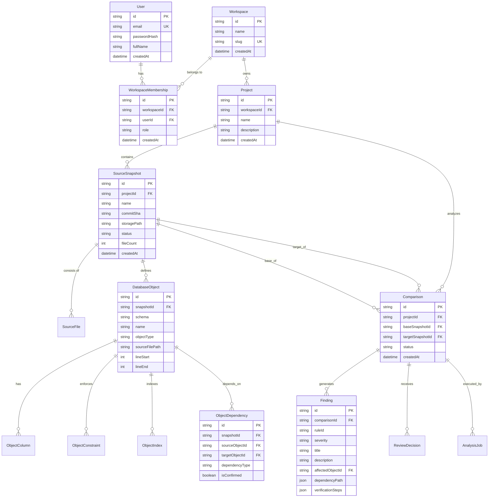

# Initial Data Model Specification — DBGuard

## 1. Overview and Design Principles

The application database for DBGuard is **PostgreSQL**, accessed and managed via **Prisma ORM**. It stores internal operational metadata, multi-tenant workspace state, snapshot manifests, and structured analysis results.

### Key Architectural Principles
1. **Strict Multi-Tenancy**: Every entity belonging to a project is anchored directly or through foreign keys to a `Workspace`. Every query enforces tenant isolation.
2. **Snapshot Immutability**: `SourceSnapshot`, `DatabaseObject`, and `ObjectDependency` records represent point-in-time states. Once marked `PARSED`, they are immutable.
3. **Reproducibility**: `Comparison` and `Finding` records preserve rule versions, analyzer engine versions, and exact dependency graphs to allow historical verification.
4. **Referential Integrity**: Cascading deletes apply to workspace removal, but snapshot deletions are safeguarded against accidental data loss.

---

## 2. Entity-Relationship Diagram (ERD)



---

## 3. Entity Definitions & Schema Specifications

### 3.1 Tenancy & IAM
* **`User`**: Registered system users.
  * Fields: `id` (UUID), `email` (unique), `passwordHash`, `fullName`, `createdAt`, `updatedAt`.
* **`Workspace`**: Tenant boundary for projects and analyses.
  * Fields: `id` (UUID), `name`, `slug` (unique), `createdAt`, `updatedAt`.
* **`WorkspaceMembership`**: User association and permissions within a workspace.
  * Fields: `id`, `workspaceId`, `userId`, `role` (`OWNER`, `ADMIN`, `DEVELOPER`, `REVIEWER`), `createdAt`.
  * Unique constraint on `[workspaceId, userId]`.

### 3.2 Projects & Snapshots
* **`Project`**: Logical repository or database target being tracked.
  * Fields: `id`, `workspaceId` (FK), `name`, `description`, `createdAt`, `updatedAt`.
  * Unique constraint on `[workspaceId, name]`.
* **`SourceSnapshot`**: Immutable representation of SQL source files at a specific revision.
  * Fields:
    * `id` (UUID)
    * `projectId` (FK)
    * `name` (e.g., "v1.2.0-main" or "PR-42")
    * `commitSha` (optional Git commit reference)
    * `storagePath` (filesystem or object storage key)
    * `contentHash` (SHA-256 digest of scripts)
    * `status` (`PENDING`, `PARSING`, `PARSED`, `PARSED_WITH_WARNINGS`, `FAILED`)
    * `fileCount`, `totalBytes`
    * `createdAt`
* **`SourceFile`**: Metadata for individual SQL files in the snapshot.
  * Fields: `id`, `snapshotId` (FK), `relativePath`, `fileSize`, `checksum`, `parseStatus`, `errorMessage`.

### 3.3 Extracted SQL Objects & Graphs
* **`DatabaseObject`**: Granular entity identified during AST parsing.
  * Fields:
    * `id` (UUID)
    * `snapshotId` (FK)
    * `schema` (e.g., "dbo", "sales")
    * `name` (e.g., "Orders", "GetCustomerDetails")
    * `objectType` (`TABLE`, `VIEW`, `STORED_PROCEDURE`, `FUNCTION`, `TYPE`, `SCHEMA`)
    * `definitionSql` (raw CREATE/ALTER statement)
    * `sourceFilePath` (relative file path)
    * `lineStart`, `lineEnd`, `colStart`, `colEnd`
  * Index on `[snapshotId, schema, name, objectType]`.
* **`ObjectColumn`**: Column definitions for tables and views.
  * Fields: `id`, `objectId` (FK), `name`, `dataType`, `length`, `precision`, `scale`, `isNullable`, `defaultValue`, `ordinalPosition`.
* **`ObjectConstraint`**: Integrity and relational constraints.
  * Fields: `id`, `objectId` (FK), `name`, `constraintType` (`PRIMARY_KEY`, `FOREIGN_KEY`, `UNIQUE`, `CHECK`, `DEFAULT`), `referencedObjectId` (nullable FK), `definitionSql`.
* **`ObjectIndex`**: Table indexes.
  * Fields: `id`, `objectId` (FK), `name`, `isUnique`, `isClustered`, `columns` (JSON array of column names).
* **`ObjectDependency`**: Edge in the static dependency graph.
  * Fields:
    * `id` (UUID)
    * `snapshotId` (FK)
    * `sourceObjectId` (FK to `DatabaseObject` - caller / referencing)
    * `targetObjectId` (FK to `DatabaseObject` - callee / referenced)
    * `dependencyType` (`REFERENCES_TABLE`, `CALLS_PROCEDURE`, `USES_FUNCTION`, `QUERIES_VIEW`, `COLUMN_USAGE`)
    * `isConfirmed` (boolean: true for confirmed AST references, false for inferred/unresolved)
    * `confidence` (float 0.0 - 1.0)
    * `sourceLocation` (JSON coordinate `{ file, line, col }`)

### 3.4 Comparison, Impact & Findings
* **`AnalysisJob`**: Asynchronous job tracker for parse and compare workloads.
  * Fields: `id`, `workspaceId` (FK), `jobType` (`PARSE_SNAPSHOT`, `COMPARE_SNAPSHOTS`), `status` (`PENDING`, `RUNNING`, `COMPLETED`, `FAILED`), `progressPercent`, `durationMs`, `errorMessage`, `createdAt`, `updatedAt`.
* **`Comparison`**: Pairwise diff and impact analysis between two snapshots.
  * Fields:
    * `id` (UUID)
    * `projectId` (FK)
    * `baseSnapshotId` (FK)
    * `targetSnapshotId` (FK)
    * `analyzerVersion` (string, e.g., "1.0.0")
    * `ruleEngineVersion` (string, e.g., "1.0.0")
    * `status` (`PENDING`, `COMPLETED`, `FAILED`)
    * `summaryJson` (JSON metrics: added/removed/modified counts, risk breakdown)
    * `createdAt`
* **`Finding`**: Detected risk or breaking change candidate.
  * Fields:
    * `id` (UUID)
    * `comparisonId` (FK)
    * `ruleId` (e.g., `RULE_DROPPED_REFERENCED_COLUMN`, `RULE_NARROWED_TYPE`)
    * `severity` (`CRITICAL`, `HIGH`, `MEDIUM`, `LOW`, `INFO`)
    * `title` (string)
    * `description` (markdown description)
    * `changedObjectId` (FK to `DatabaseObject` or identifier)
    * `affectedObjectId` (FK to `DatabaseObject` or identifier)
    * `dependencyPath` (JSON array of nodes/edges representing traversal from changed to affected object)
    * `confidence` (enum: `HIGH`, `MEDIUM`, `LOW`)
    * `evidenceSnippet` (source code snippet around offending line)
    * `verificationSteps` (JSON array of actionable review recommendations)
    * `createdAt`
* **`ReviewDecision`**: Audit log of developer/reviewer approvals and feedback.
  * Fields: `id`, `comparisonId` (FK), `userId` (FK), `decision` (`APPROVED`, `CHANGES_REQUESTED`, `DISMISSED`), `comment`, `createdAt`.

---

## 4. Query & Isolation Safeguards

All repository/service methods in NestJS will require an explicit `workspaceId` parameter in the query where clause:

```typescript
// Architectural Rule: Tenant isolation check in every query
const project = await prisma.project.findFirst({
  where: {
    id: projectId,
    workspaceId: currentWorkspaceId, // Required tenant boundary
  },
});
```
Direct access by ID without workspace boundary validation is prohibited.
