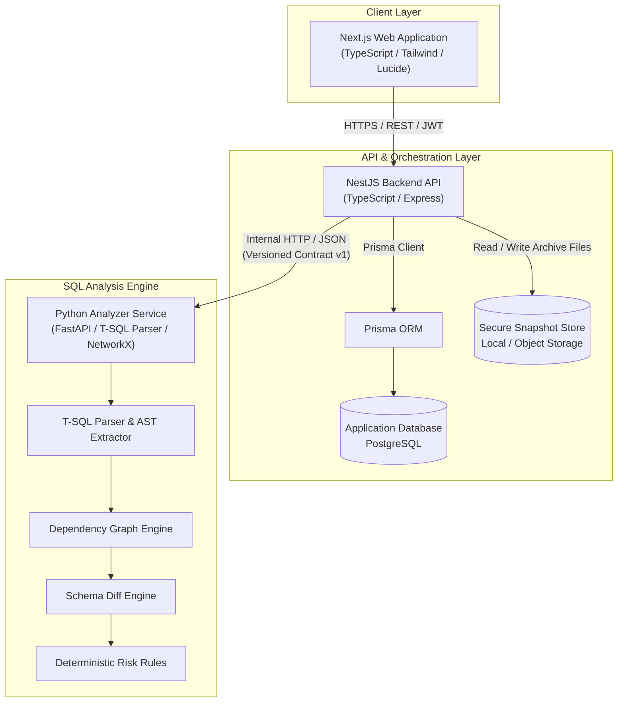
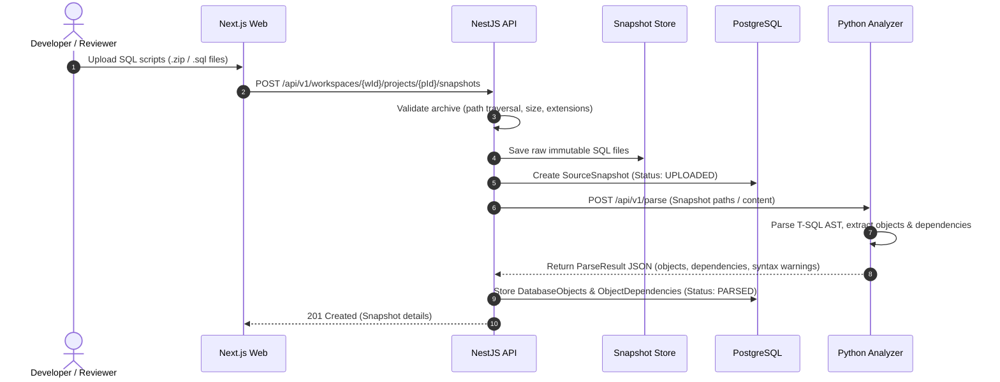
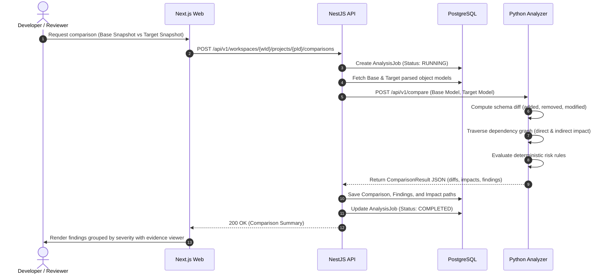

# System Architecture Document — DBGuard

## 1. High-Level Architecture Overview

DBGuard is designed as a modular, decoupled system with strict functional boundaries. It separates user management, tenancy, and orchestration from compute-intensive static SQL parsing and graph traversal.

---

## 2. Component Boundaries and Responsibilities

### 2.1 Next.js Frontend (`apps/web`)
* **Technology**: Next.js (App Router), TypeScript, Tailwind CSS, component system.
* **Responsibilities**:
  * User authentication and workspace context switching.
  * Project creation, snapshot file uploads, and snapshot selection.
  * Interactive visualization of schema diffs, dependency trees, and risk findings.
  * Status monitoring of asynchronous analysis jobs.
  * Rendering evidence snippets (source code viewer with line highlights).
* **Boundaries**:
  * Communicates exclusively with the NestJS API over HTTPS REST.
  * Never interacts directly with the Python Analyzer or PostgreSQL database.

### 2.2 NestJS Backend API (`apps/api`)
* **Technology**: NestJS, TypeScript, Passport/JWT, Class-Validator, Prisma ORM.
* **Responsibilities**:
  * Authentication, session lifecycle, and workspace role-based authorization (RBAC).
  * Enforcing tenant boundaries on all requests, queries, and background operations.
  * Ingestion, validation, and sanitization of uploaded `.sql` source archives.
  * Storing snapshot metadata in PostgreSQL and staging raw scripts in the secure snapshot store.
  * Orchestrating analysis jobs (dispatches payloads to the Python Analyzer, receives structured responses, and persists findings/dependencies).
  * Providing uniform, structured REST responses and error envelopes.
* **Boundaries**:
  * Owns the application database and metadata.
  * Delegates all T-SQL parsing, schema diffing, and risk evaluation to the Python Analyzer.

### 2.3 Python SQL Analysis Engine (`apps/analyzer`)
* **Technology**: Python 3.12+, FastAPI (lightweight HTTP interface), `pytest`, NetworkX (graph traversal), T-SQL parsing library.
* **Responsibilities**:
  * Static lexical and AST analysis of T-SQL DDL and DML scripts.
  * Database object extraction (tables, columns, views, stored procedures, functions, constraints, indexes).
  * Building directed dependency graphs with cycle detection.
  * Comparing two parsed snapshots to generate structural deltas.
  * Evaluating deterministic risk rules against deltas and dependency trees.
* **Boundaries & Constraints**:
  * **Stateless & Read-Only**: Holds no persistent state; accepts SQL files or structured ASTs, returns analysis JSON.
  * **No Direct DB Access**: Has no connection to PostgreSQL or any customer database.
  * **Sandboxed Execution**: Operates under strict file access and execution restrictions. Never executes or evaluates SQL code.

### 2.4 Application Database (`database/prisma`)
* **Technology**: PostgreSQL with Prisma ORM.
* **Responsibilities**:
  * Relational storage for tenants, users, projects, snapshot metadata, extracted object summaries, and immutable analysis reports.
  * Note: PostgreSQL is strictly for DBGuard internal application data, completely separate from customer SQL Server targets.

---

## 3. Communication Protocol Decision

### Decision: Versioned HTTP / REST Interface between NestJS API and Python Analyzer

| Option | Pros | Cons | Decision |
| :--- | :--- | :--- | :--- |
| **HTTP / REST (JSON Contracts)** | Simple, transparent, inspectable, decoupled development, easy local setup, standard error handling. | Serialization overhead on very large ASTs. | **Chosen for V1**. Avoids introducing message brokers before workload justifies it. |
| **gRPC / Protocol Buffers** | Compact binary serialization, strict typing. | Added build toolchain complexity, more complex debugging. | Deferred to future iterations if JSON serialization becomes a bottleneck. |
| **Message Broker (RabbitMQ / Redis)** | Decoupled queueing for async jobs. | Additional infrastructure dependencies and operational complexity. | Deferred until worker scale requires distributed queues. |

**Execution Model for Long-Running Jobs**:
1. For V1, the NestJS API initiates analysis via synchronous or tracked HTTP request with timeout controls.
2. In-process job state tracking (`PENDING`, `PARSING`, `COMPARING`, `COMPLETED`, `FAILED`) in PostgreSQL ensures resilience and transparent frontend polling.

---

## 4. End-to-End Data Flow

### 4.1 Ingestion and Parsing Flow

### 4.2 Comparison and Impact Analysis Flow

---

## 5. Failure Scenarios and Recovery

| Failure Scenario | Impact | System Mitigation & Recovery |
| :--- | :--- | :--- |
| **Unparseable T-SQL Syntax** | Specific `.sql` file contains proprietary or unsupported syntax. | Analyzer records a `SyntaxWarning` with file, line, and column coordinates, isolates the broken statement, and continues parsing remaining files. Snapshot marked `PARSED_WITH_WARNINGS`. |
| **Circular Dependencies** | Stored procedures or views exhibit recursive cross-references. | Graph engine utilizes Tarjan's or cycle-detection algorithms to detect loops, marks edges with `has_cycle: true`, and avoids infinite recursion. |
| **Analyzer Process Timeout** | Extremely large SQL script exceeds standard analysis window. | NestJS enforces request timeout (e.g., 60s); marks `AnalysisJob` as `FAILED` with code `ANALYZER_TIMEOUT`; preserves logs for diagnostic triage. |
| **Path Traversal in Upload** | Malicious zip containing `../../etc/passwd`. | Archive extractor validates every entry destination against canonical target directory; rejects archive before writing to disk. |
| **Missing Target Snapshot Object** | Target snapshot drops an object that has active dependents. | Impact engine flags high-severity finding (`RULE_DROPPED_REFERENCED_OBJECT`) with full dependency trace. |
