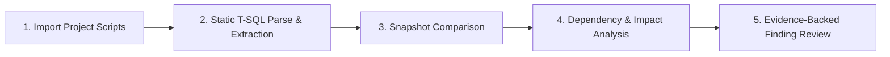

# Product Requirements Document (PRD) — DBGuard V1

## 1. Executive Summary

**DBGuard** (internally codenamed **Kafei**) is an enterprise database engineering platform designed to eliminate risks in database schema migrations and T-SQL modifications. By performing static analysis on Microsoft SQL Server DDL/DML scripts prior to deployment, DBGuard detects breaking changes, maps object dependencies, traces impact cascades, and generates evidence-backed risk assessments.

DBGuard guarantees a **strict read-only, non-execution paradigm**: customer SQL scripts are never executed against a live database, no production connections are required, and all analysis is deterministic and inspectable.

---

## 2. Target Users and Personas

| Persona | Primary Needs & Goals | Core DBGuard Use Cases |
| :--- | :--- | :--- |
| **Backend Developers** | Safe application-database iteration; fast feedback on whether ORM or SQL migrations break existing views or queries. | Upload migration scripts before merging PRs; review affected endpoints and queries; verify column removals or type modifications. |
| **SQL Server Developers** | Deep understanding of complex T-SQL schemas; verifying stored procedures, functions, constraints, and index impacts. | Identify recursive or nested dependencies; detect parameter signature drifts; ensure view definitions stay valid. |
| **Database Administrators (DBAs)** | Schema governance; preventing downtime caused by missing indexes, lock-inducing constraint additions, or dropped tables. | Review incoming changes against policy; audit schema lineage; evaluate non-breaking migration plans before approving release. |
| **Database Reviewers / Tech Leads** | Objective, evidence-based review workflows; approving or requesting alterations on schema changes. | Inspect side-by-side snapshot diffs, follow dependency graph paths, and verify rule-triggered risk ratings. |
| **Workspace Administrators** | Project lifecycle management, role-based access control, audit logs, and workspace configuration. | Manage team access, define project repository targets, and configure tenant settings. |

---

## 3. Core V1 Workflow

The end-to-end workflow follows five distinct stages:

1. **Import Project Scripts**:
   * Users supply SQL script collections (via directory upload, archive, or individual `.sql` files).
   * Scripts are ingested as an immutable **Source Snapshot** tagged with a commit SHA or timestamp.
2. **Static T-SQL Parse & Extraction**:
   * The Python Analyzer parses T-SQL syntax without executing scripts.
   * Entities (tables, columns, views, stored procedures, functions, keys, constraints, indexes) are extracted with precise source file coordinates (file, line, column).
   * Unresolved syntax or partial batches are isolated and reported; independent files continue processing.
3. **Snapshot Comparison**:
   * Two snapshots (e.g., `Base/Production` vs. `Target/Feature`) are compared.
   * Structural diffs identify added, dropped, or modified objects, column changes (type, nullability, defaults), and parameter alterations.
4. **Dependency & Impact Analysis**:
   * The analyzer traverses the parsed dependency graph.
   * Direct and transitive dependents of changed objects are gathered along with the exact dependency path.
5. **Evidence-Backed Finding Review**:
   * Deterministic, versioned risk rules evaluate detected changes against impacted objects.
   * Reviewers view findings categorized by severity, accompanied by line references, confidence ratings, and recommended verification steps.

---

## 4. Scope Specification: V1 vs. Deferred

### In Scope for V1

* **Database Engine**: Microsoft SQL Server (T-SQL syntax).
* **Static Analysis**: Pure AST and token-based parsing of `.sql` source scripts.
* **Objects Supported**: Tables, columns, views, stored procedures, user-defined functions (scalar and table-valued), primary keys, foreign keys, check constraints, default constraints, unique constraints, and indexes.
* **Dependency Resolution**:
  * Procedures referencing tables/views/procedures.
  * Views referencing tables/views.
  * Functions referencing tables/functions.
  * Explicit column references where resolvable.
  * Classification into confirmed, inferred, and unresolved references.
* **Comparison Engine**:
  * Diffing between two immutable snapshots.
  * Column additions, deletions, nullability changes, data type modifications.
  * Key/constraint additions and drops.
  * Stored procedure parameter additions, removals, and type shifts.
* **Impact & Risk Rules**:
  * Dropping or renaming referenced columns.
  * Changing column nullability (nullable $\rightarrow$ non-nullable without default).
  * Narrowing data type width or precision (e.g., `VARCHAR(100)` $\rightarrow$ `VARCHAR(50)`).
  * Stored procedure signature breaks (removed parameter or added non-default parameter).
  * Broken view definitions (underlying column removed).
* **Tenant & Access Control**:
  * Multi-tenant workspace isolation.
  * Roles: Workspace Owner, Admin, Developer, Reviewer.
* **Web Experience**:
  * Workspace/Project dashboard.
  * Snapshot explorer and comparison view.
  * Findings list with severity filters, evidence viewer, and dependency path tree.
* **Reports**:
  * Structured export of comparison findings and evidence (JSON / Markdown / HTML report).

### Explicitly Deferred Beyond V1

* **Live Database Connections**: No direct JDBC/ODBC connections to live customer databases.
* **Script Execution & Automated Migrations**: DBGuard will not run DDL or deploy changes.
* **Non-MSSQL Engines**: PostgreSQL, MySQL, Oracle, and Snowflake engines are deferred.
* **External AI / LLM Integrations**: The core analysis and risk engine will remain 100% deterministic, reproducible, and verifiable.
* **Real-Time Performance Profiling**: Query plan execution stats, index usage stats, and wait stats are out of scope.
* **Backup & Recovery Orchestration**: Automated backup verification is deferred.
* **Enterprise SSO & SCIM**: SAML/Okta integration is deferred until later enterprise phases.
* **GitHub Action / CLI Plugin**: Scheduled for subsequent sprints following foundational web release.

---

## 5. Success Metrics for V1

1. **Zero Production Risk**: 0 customer database writes or code executions.
2. **Analysis Completeness**: Clear attribution of 100% of parsed objects; transparent flagging of any unparseable batches.
3. **Explainability**: Every risk finding points to specific line numbers, rule IDs, and traversed dependency nodes.
4. **Tenant Isolation**: 0 leakage of snapshots, projects, or findings across workspaces.
