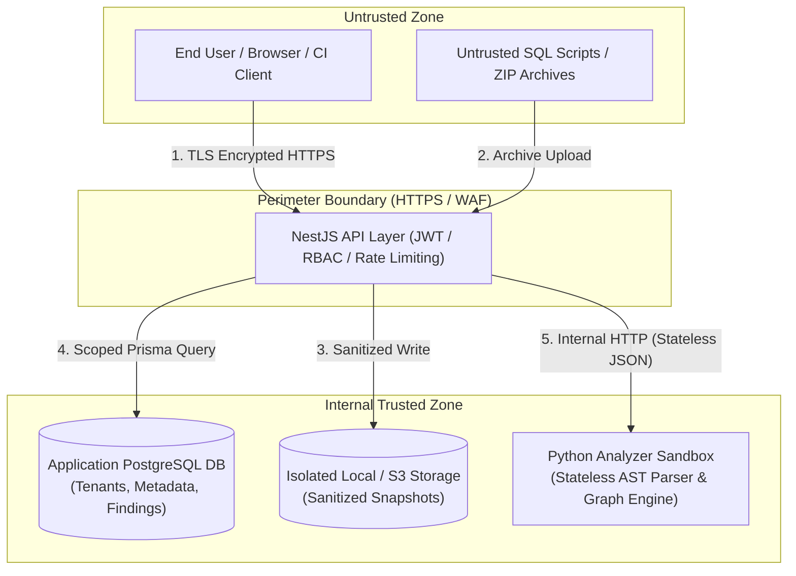

# Threat Model & Security Boundaries — DBGuard V1

## 1. Security Philosophy and Posture

DBGuard operates as an enterprise-grade static analysis tool. A core tenet of DBGuard's design is **Zero Execution, Zero Customer Database Access**:
1. **Never Execute Customer SQL**: Customer DDL/DML scripts are treated strictly as untrusted text input for parsing into an Abstract Syntax Tree (AST). No script is ever executed in a database, container, or shell.
2. **Never Connect to Production Databases**: DBGuard does not require, accept, or store customer production database credentials or network access credentials.
3. **No External AI Data Transmission**: Customer database schemas, metadata, and script definitions are processed completely on-premise/in-cluster and are never dispatched to external LLMs or third-party cloud APIs.

---

## 2. Trust Boundaries and System Assets



### Key Protected Assets
* **Customer Intellectual Property**: Proprietary database schemas, stored procedure logic, table structures, and internal business logic contained within SQL files.
* **Tenant Metadata & Findings**: Analysis reports, discovered vulnerabilities, and breaking-change logs across multiple workspaces.
* **System Credentials**: Database connection strings for DBGuard's internal PostgreSQL instance, JWT signing secrets, and service-to-service keys.

---

## 3. Threat Modeling (STRIDE Matrix)

| Threat Category | Specific Attack Vector | Target Asset | Impact | Mitigation Strategy |
| :--- | :--- | :--- | :--- | :--- |
| **Spoofing** | Forged JWT or session impersonation | Tenant data | Unauthorized access across workspaces | Cryptographically signed asymmetric or strong HMAC-SHA256 JWTs with tight expirations; revocation lists. |
| **Tampering** | Modification of stored snapshot files or findings | Snapshot integrity & review decisions | Inaccurate safety reports; masked breaking changes | Immutable snapshot storage; content hashing (SHA-256) checked on read; write-once findings. |
| **Repudiation** | User denies approving a dangerous breaking change | Audit trail | Inability to establish deployment accountability | Dedicated `ReviewDecision` audit logs recording authenticated user ID, timestamp, comparison ID, and action. |
| **Information Disclosure** | Cross-tenant data leakage via IDOR (Insecure Direct Object Reference) | Schemas & findings of other tenants | Exposure of another organization's proprietary schema | Mandatory workspace ID filter enforced at repository/service query layer on every lookup. Unguessable UUIDs. |
| **Information Disclosure** | Verbose error stack traces exposing internal architecture | Backend system paths, libraries | Reconnaissance for further exploits | Global NestJS Exception Filters sanitize all 5xx errors; emit only unique incident IDs to clients while logging full traces securely. |
| **Denial of Service** | "Zip Bomb" (highly compressed archive) | Filesystem & memory exhaustion | API crash, server downtime | Archive decompression limits: max uncompressed size (e.g. 100 MB), max file count (1,000 files), compression ratio checks. |
| **Denial of Service** | Recursive or pathological SQL causing parser hang (ReDoS / AST loop) | Analyzer CPU & memory | Engine starvation | Hard execution timeouts (e.g., 60 seconds per parse job), memory limits on analyzer container, non-backtracking parsing algorithms. |
| **Elevation of Privilege** | Path traversal via zip filenames (`../../etc/passwd` or overwrite) | Host filesystem | Arbitrary file overwrite or system compromise | Canonical path resolution check on every zip entry; reject any entry containing relative path sequences (`..`) or leading slashes. |

---

## 4. Specific Security Boundary Protections

### 4.1 Untrusted Archive & Script Ingestion
All uploaded files undergo strict pre-processing:
1. **MIME & Extension Enforcement**: Only `.sql` files or `.zip` archives containing `.sql` files are accepted.
2. **Canonical Path Verification**:
   ```typescript
   const destinationPath = path.resolve(targetDir, entry.entryName);
   if (!destinationPath.startsWith(path.resolve(targetDir))) {
     throw new SecurityException('Path traversal detected in archive entry');
   }
   ```
3. **Hard Size Caps**: Single snapshot uploads capped at 25 MB compressed / 100 MB uncompressed.

### 4.2 Multi-Tenant Data Isolation
Every API endpoint operating on projects, snapshots, or comparisons requires an explicit `:workspaceId` context in the URL:
1. The authentication guard extracts the user's ID from the validated JWT.
2. The authorization guard verifies active membership in the target workspace.
3. The Prisma repository layer injects `workspaceId` into all database operations.
4. Attempting to access an entity belonging to another workspace yields a uniform `404 Not Found` to prevent entity enumeration.

### 4.3 Sandboxed Analyzer Execution
* The Python SQL Analyzer is deployed in an isolated, non-root Linux container or process sandbox.
* The analyzer has **no outbound internet access** and cannot open network connections outside the designated internal API network.
* The analyzer operates as a pure function: it accepts input text/JSON, builds ASTs, evaluates graphs, and returns JSON.

---

## 5. Security Verification and Testing Strategy

1. **Path Traversal Tests**: Automated test suites verifying archive extraction with malformed and adversarial zip archives.
2. **Tenant Isolation Tests**: Integration test suites verifying that User A in Workspace A cannot query, modify, or view snapshots in Workspace B, even with known UUIDs.
3. **AST Parser Fuzzing**: Test fixtures containing deeply nested queries, deliberate syntax corruptions, and cyclic procedure calls to ensure graceful error handling without crashes.
4. **Credential Leak Prevention**: Automated CI secret scanning (e.g., gitleaks) preventing API keys or private tokens in commits.
